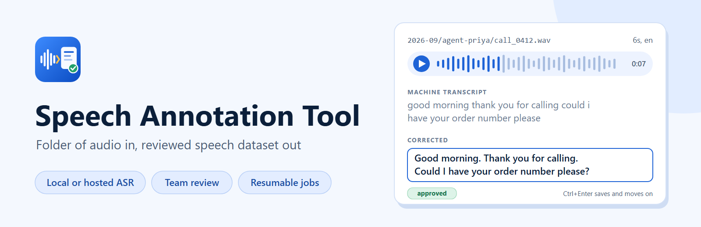
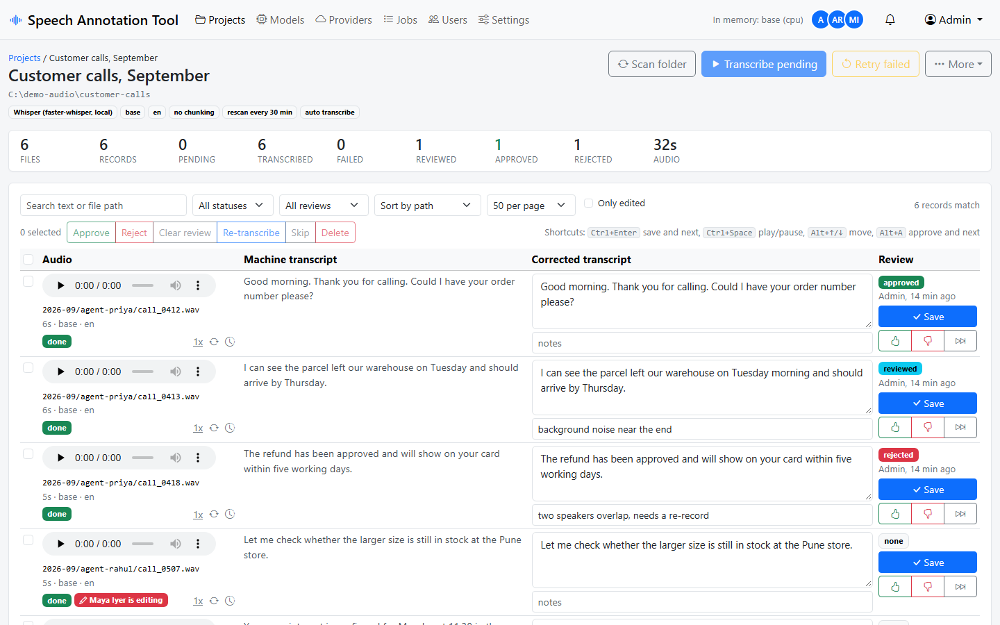
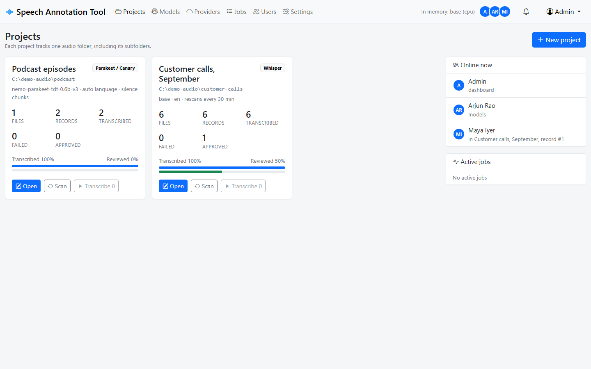
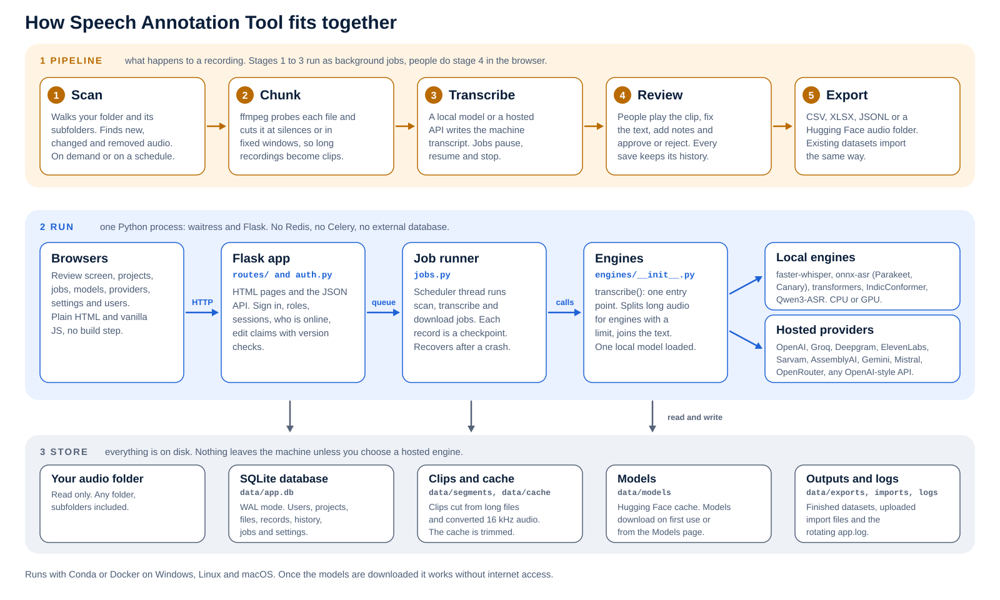

# Speech Annotation Tool

<p align="center">
  
</p>

[](LICENSE)
[](environment.yml)
[](docs/setup.md)
[](https://github.com/sponsors/inboxpraveen)

Turn a folder of audio into a reviewed speech dataset. Point the tool at a folder, pick a speech recognition engine (local model or hosted API), and it scans, transcribes, and lets your team correct the results in the browser. Export as CSV, Excel, JSON Lines or a Hugging Face style audio folder.

Runs on Windows, Linux and macOS with Conda, or anywhere with Docker. No models ship with the repo; you download the ones you want from inside the app.



## What it does

- Tracks one audio folder per project, subfolders included. Only audio files are picked up; everything else is ignored.
- Rescans on demand or on a schedule and notices new, changed and removed files.
- Splits long recordings at silences (or fixed windows) so each record is a short clip.
- Transcribes with local models (Whisper through faster-whisper, NVIDIA Parakeet and Canary through onnx-asr, any Hugging Face model through transformers, AI4Bharat IndicConformer, Qwen3-ASR) or hosted APIs (OpenAI, Groq, Deepgram, ElevenLabs, Sarvam, AssemblyAI, Google Gemini, Mistral, OpenRouter, any OpenAI compatible server).
- Review screen with audio player, machine transcript, editable corrected text, notes, approve/reject, keyboard shortcuts and edit history.
- Imports existing datasets and corrections from CSV, TSV, XLSX, JSON or JSONL.
- Background jobs with progress, pause, resume and stop. Jobs survive a crash or restart and continue from the last finished record.
- Accounts for your team. Everyone sees who is online and which record they are editing; two people can never overwrite each other.
- In-app notifications for finished jobs, new audio and errors.
- One local model in memory at a time, unloaded when idle. Works on a laptop CPU; uses a GPU when one is available.



## Quick start with Conda

Requires [Miniconda or Anaconda](https://www.anaconda.com/download). ffmpeg is installed by the environment file, nothing else to set up.

```bash
git clone https://github.com/inboxpraveen/Speech-Annotation-Tool.git
cd Speech-Annotation-Tool
conda env create -f environment.yml
conda activate speech-annotation-tool
python app.py
```

Open http://localhost:8000 and sign in with `admin` / `admin`. Change the password from the user menu; the app logs a warning at every start while the default is still in use.

To use another port or listen only on this machine, copy `.env.example` to `.env` and edit it, or run `python app.py --port 9000`.

## Quick start with Docker

```bash
git clone https://github.com/inboxpraveen/Speech-Annotation-Tool.git
cd Speech-Annotation-Tool
cp .env.example .env      # set AUDIO_DIR to the folder that holds your audio
docker compose up -d --build
```

Open http://localhost:8000. Your audio folder appears inside the app as `/audio`. The database, downloaded models, segments and exports live in `./data` on the host, so they survive container rebuilds.

On Windows set `AUDIO_DIR=C:\recordings` (or any folder) in `.env`. See [docs/setup.md](docs/setup.md) for GPU containers and other details.

Sharing the app with a team? Read [Running it for a team](docs/setup.md#running-it-for-a-team) first: change the admin password, put HTTPS in front, and back up `data/app.db`.

## First project

1. Click **New project**, give it a name and browse to the folder with your audio.
2. Pick an engine and model. Start with Whisper `base` or `small` on a CPU, or Parakeet TDT v3 for European languages. For hosted providers add the API key under **Providers** first.
3. Choose chunking. "Split at silences" with a 15 to 25 second target works well for datasets; "None" keeps one record per file.
4. Create the project. The folder is scanned and transcription starts. Progress shows at the top of every page.
5. Open the project, listen, fix the text, press **Ctrl+Enter** to save and move on. Approve or reject with the thumb buttons.
6. **More > Export dataset** when you are done.

## Engines

| Local (runs on this machine) | Hosted (API key needed) |
|---|---|
| Whisper: tiny to large-v3 and large-v3-turbo through faster-whisper | OpenAI: gpt-4o-transcribe, gpt-4o-mini-transcribe, gpt-transcribe, whisper-1 |
| NVIDIA Parakeet TDT v2/v3, Parakeet CTC, Canary 1B v2 through onnx-asr | Groq: whisper-large-v3-turbo, whisper-large-v3 |
| Any Hugging Face speech model the transformers pipeline supports (Whisper, Distil-Whisper, wav2vec2, Moonshine, IndicWav2Vec) | Deepgram: nova-3, nova-3-medical, nova-2 |
| AI4Bharat IndicConformer 600M, 22 Indian languages (gated repo, needs a Hugging Face token) | ElevenLabs Scribe v2 and v1 |
| Qwen3-ASR 0.6B and 1.7B (install `qwen-asr` first) | Sarvam Saaras v4 and v3 |
| | AssemblyAI Universal-3.5 Pro, Universal-2, Slam-1 |
| | Google Gemini 3.5 Transcribe and general Gemini models |
| | Mistral Voxtral |
| | OpenRouter, any audio-capable model |
| | Any OpenAI compatible server (Speaches, LocalAI, vLLM, whisper.cpp server, LM Studio and others) |

Models download from Hugging Face on first use, or ahead of time from the **Models** page. Every engine has a **Test with sample clip** button so you can check it works before starting a big job. Details, languages and limits are in [docs/providers.md](docs/providers.md).

## How it is built

- Python 3.12, Flask, waitress. One process, no Redis, no Celery, no external database.
- SQLite in WAL mode. Every record is written on its own, which is what makes pause, resume and crash recovery work.
- ffmpeg for all audio handling, streamed through subprocesses so file size does not matter.
- Plain HTML, Bootstrap and vanilla JavaScript, all served locally. The app works without internet access once models are downloaded.



## Documentation

- [Setup](docs/setup.md): Conda, Docker, GPU, running it for a team, environment variables, updating
- [Usage](docs/usage.md): projects, scanning, review workflow, import, export, jobs, users
- [Providers and models](docs/providers.md): every engine, its models, languages and limits
- [Troubleshooting](docs/troubleshooting.md)
- [Development](docs/development.md): code layout, API, tests
- [Security policy](SECURITY.md) and [Changelog](CHANGELOG.md)

## Support the project

The tool is free and MIT licensed. If it saves your team time, you can [sponsor its development](https://github.com/sponsors/inboxpraveen). Bug reports, pull requests and stars help as much; see [CONTRIBUTING.md](CONTRIBUTING.md).

## License

MIT. See [LICENSE](LICENSE).
