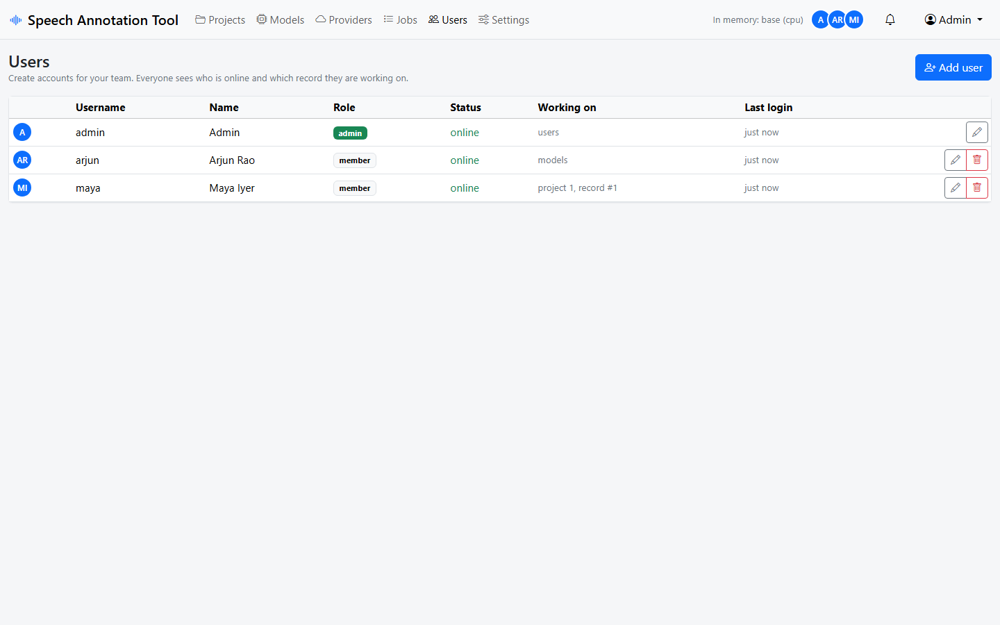
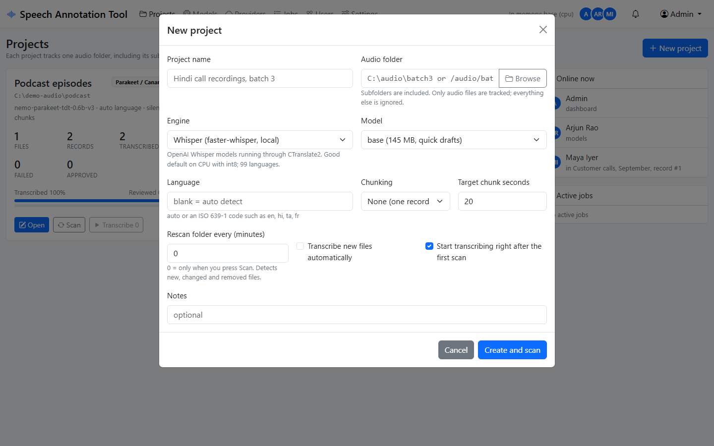
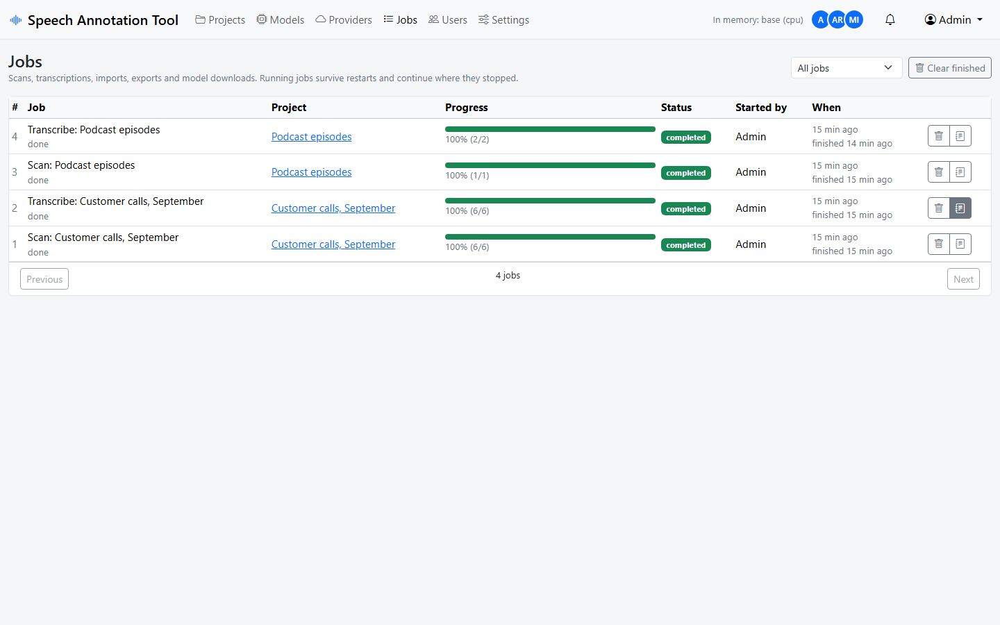
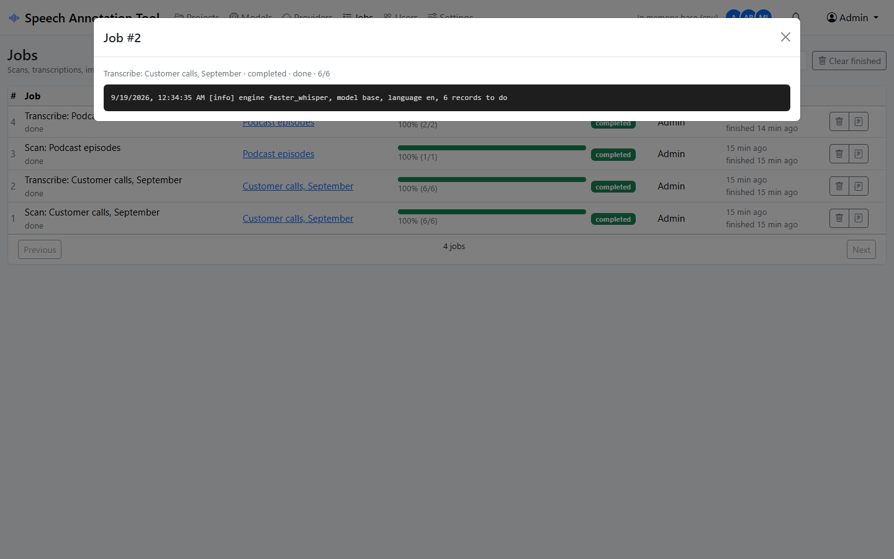
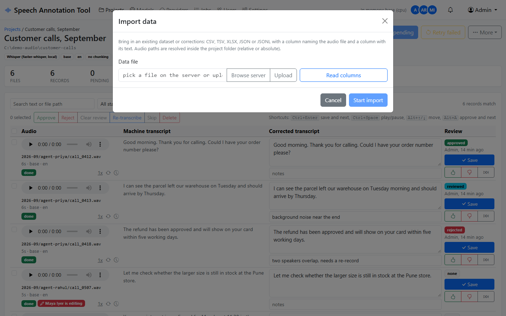
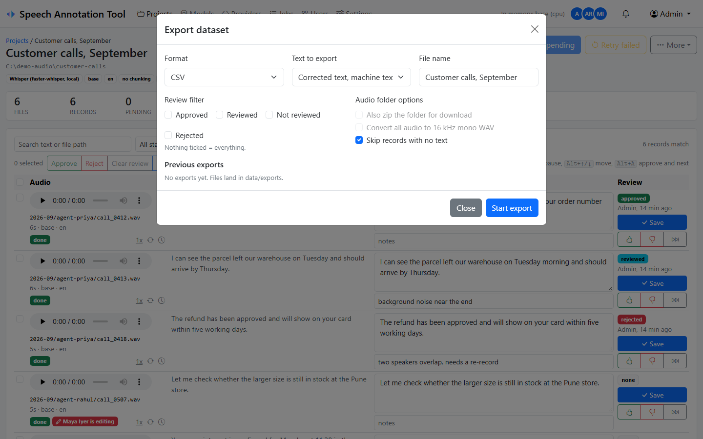
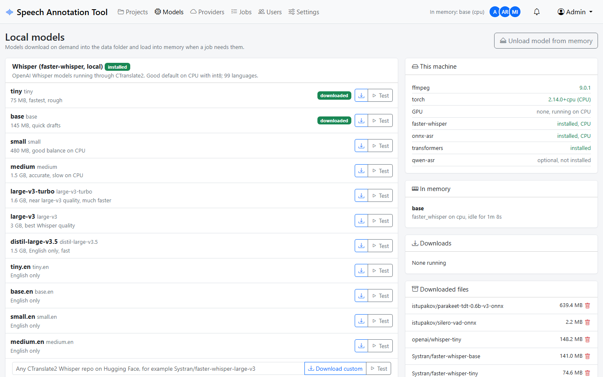
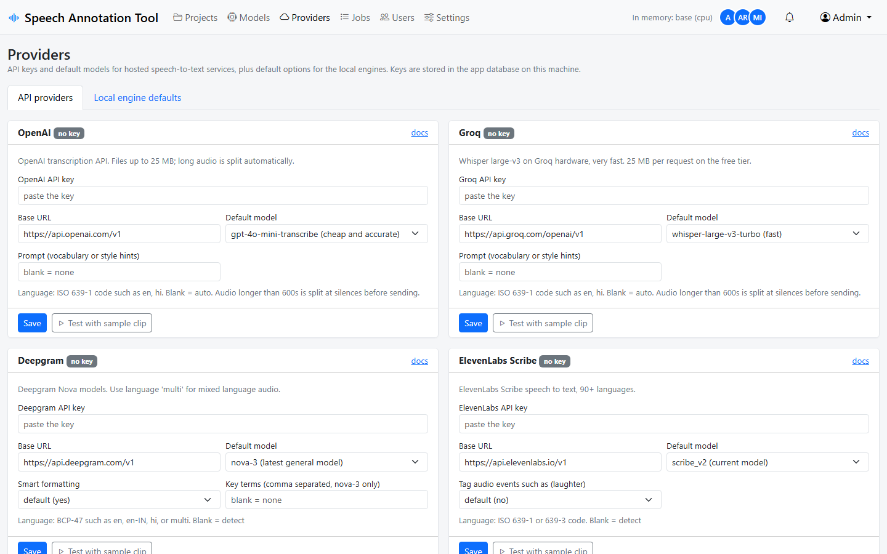
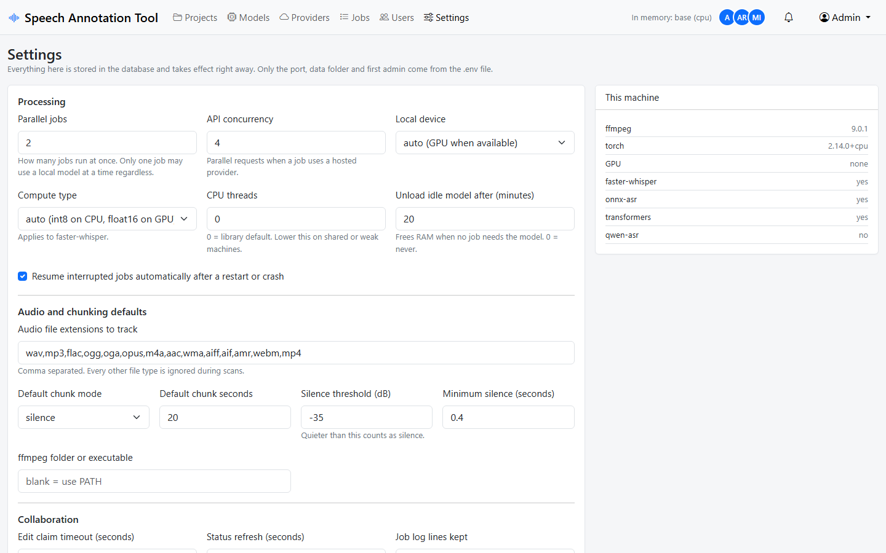

# Usage

## Signing in and accounts

The first admin comes from `.env` (`admin` / `admin` by default). Admins create accounts for everyone else under **Users**: username, display name, password and role. There is no self sign-up.

- **Admin**: everything, including users, settings, API keys and deleting models.
- **Member**: create and work on projects, run jobs, download models, use the providers that an admin configured.

The avatars in the top bar show who is online right now. The Users page and the dashboard show what each person is doing, down to the record they have open.

## Projects

A project is one audio folder plus the settings used to transcribe it. Subfolders are included. Files are matched by extension (Settings > Audio file extensions); text files, images and anything else in the folder are ignored, as are hidden folders and things like `$RECYCLE.BIN`.

Settings when creating a project:

- **Engine and model**: which speech recognizer to use. Can be changed later; new transcriptions use the new choice, existing text stays.
- **Language**: leave blank to let the model detect it, or give a code. Each engine says what it expects (for example `en`, `hi-IN`, or `multi` for Deepgram). IndicConformer requires a language.
- **Chunking**: how long recordings become records.
  - *None*: one record per file.
  - *Split at silences*: cut at quiet moments close to the target length (default 20 seconds). Files shorter than 1.5 times the target are not cut. Best for datasets.
  - *Fixed length windows*: hard cuts every N seconds.
- **Rescan every N minutes**: 0 means only when you press Scan. Otherwise the folder is checked on that interval and new files are picked up.
- **Transcribe new files automatically**: new records found by a scheduled or manual scan are queued right away.

Chunks are written as 16 kHz mono WAV under `data/segments/<project>/<file>/`. The original files are never modified.

## Scanning and change detection

Every scan walks the folder and compares size and modification time against what it knows:

- **new**: a file that was not there before. It gets records (one, or one per chunk) with status *pending*.
- **changed**: size or time differ. The file is flagged and its records keep their text. Use **More > Files > Re-prepare changed files** to cut fresh chunks and queue them again. For unchunked projects the record simply goes back to pending and keeps any corrected text.
- **missing**: the file is gone. Records stay so no work is lost; they show "audio file is missing". They come back to *ready* if the file returns.
- **error**: ffmpeg could not read it. The reason shows in the Files dialog. Errors are retried on the next scan.

Scanning is streamed. A folder with 100,000 files works; the scan reports progress as it goes.

## Transcribing

**Transcribe pending** queues a job for every record in status *pending*. **Retry failed** puts failed records back in the queue first. Both run in the background; you can keep reviewing while they run.

The job panel at the top of the project shows progress and offers **Pause**, **Resume** and **Stop**. Pausing finishes the record in flight and leaves the rest pending. Resuming continues where it stopped. If the app crashes or the machine restarts, running jobs are queued again automatically (Settings > Resume interrupted jobs) and pick up at the next unfinished record.

A configuration problem that would fail every record (missing API key, wrong URL, ffmpeg not found) stops the job after the first attempt instead of failing everything. Fix the problem and resume.

To transcribe one record again, use the circular arrow on its row. To redo a batch, tick the rows and press **Re-transcribe** in the bulk bar. Both use the project's current engine.

Only one job at a time may hold a local model, so a model download or a second local transcription waits behind the running one. Hosted providers run several records in parallel (Settings > API concurrency) and are not limited this way.

Every job keeps a log with what it did and why a record failed:

## Reviewing

Each row has the audio player, the machine transcript on the left and the editable corrected text on the right.

- Edit the text and press **Save**, or **Ctrl+Enter** to save and jump to the next row. Saving marks the record as *reviewed*.
- Thumbs up saves and marks it *approved*, thumbs down *rejected*. **Alt+A** approves and moves on.
- **Ctrl+Space** plays or pauses the row's audio. **Alt+Up / Alt+Down** move between rows. The `1x` link cycles playback speed.
- The notes field is free text (background noise, second speaker, anything).
- The clock icon shows the edit history: who changed what and when.
- **Skip** marks a record you do not want in the dataset.

Filters at the top narrow the list by status, review state, text search or file path. "Only edited" shows records with corrected text. Sorting and page size are next to the filters.

When you start editing a row it is claimed for you. Others see a red "is editing" badge on that row and cannot save it until you finish or stop typing for three minutes (Settings > Edit claim timeout). Saves also carry a version number, so if two people did manage to edit the same record, the second save is refused with a message instead of overwriting the first.

Bulk actions on ticked rows: approve, reject, clear review, re-transcribe, skip, delete.

## Import

**More > Import data** brings in an existing dataset or a set of corrections.

1. Pick a CSV, TSV, XLSX, JSON or JSONL file on the server, or upload one from your computer.
2. Press **Read columns** and map the audio column, the text column and (optionally) the corrected text column. Common names such as `filename`, `audio`, `path`, `text`, `transcription`, `corrected_text` and `correct_transcripts` are picked automatically, so files from the previous version of this tool import as they are.
3. Choose what happens when a record already exists for the same audio: skip it, or update its text.
4. Optionally mark rows that carry corrected text as *reviewed*.

Audio paths are resolved relative to the project folder (or the base folder you give). Absolute paths inside the project folder work too. Rows whose audio cannot be found are still imported and flagged *missing*, so the text is not lost.

## Export

**More > Export dataset** starts an export job. Pick a format:

- **CSV**, **XLSX**, **JSONL**: one row per record with the audio path, file, segment, timing, machine text, corrected text, final text, status, review, provider, model, language, notes and last update.
- **Audio folder**: a folder with `metadata.csv` and the audio files, in the layout Hugging Face `audiofolder` datasets expect (`file_name` plus a `transcription` column). Optionally converted to 16 kHz mono WAV and zipped for download.

Choose which text to export (corrected with machine fallback, corrected only, or machine only) and which review states to include. Skipped records and records without any text are left out. Exports land in `data/exports/` and are listed in the dialog with download links. A notification tells you when the file is ready.

## Models page

Lists every local engine with its catalog of models, what is already downloaded, what is loaded in memory, and the machine's capabilities (ffmpeg, torch, GPU). Download a model ahead of time, test any model with the built-in sample clip, or type a custom Hugging Face repo id. Admins can delete downloaded models and store a Hugging Face token for gated repositories such as IndicConformer.

## Providers page

API keys, base URLs, default models and per-provider options for the hosted services, plus default options for the local engines (beam size, VAD, quantization and so on). Every card has **Test with sample clip**. Keys are stored in the app database on this machine and only admins can change them.

## Notifications

The bell shows unread notifications: finished or failed jobs, new audio found by a scheduled scan, exports ready to download. New ones also pop up as toasts on whatever page you are on. The blue bar under the top navigation shows jobs that are running right now.

## Settings

Admin only. Parallel jobs, API concurrency, device and compute type for local models, CPU threads, idle unload, audio extensions, chunking defaults, silence detection thresholds, ffmpeg location, claim timeout and status refresh interval. Changes apply immediately.

